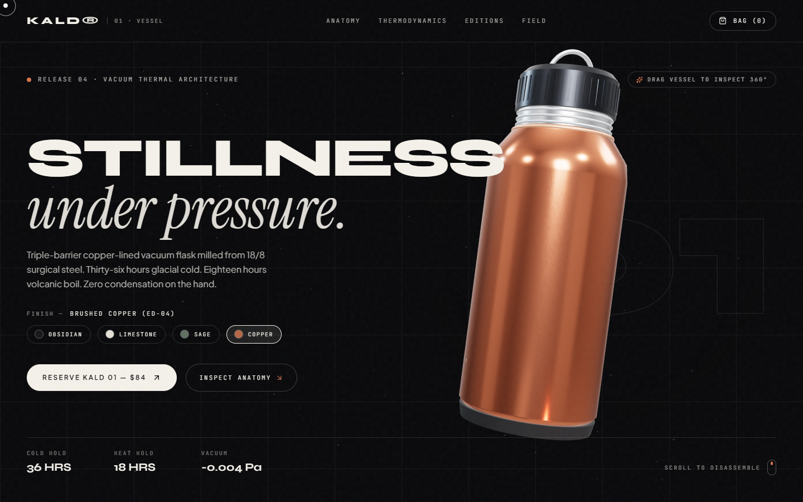
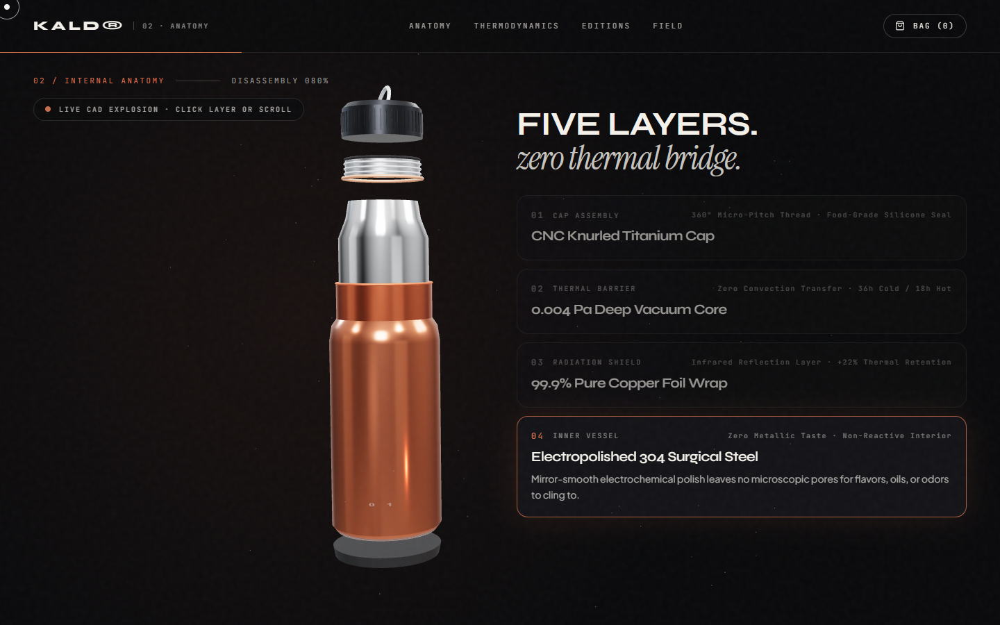

# KALD® — 01 Vacuum Vessel

An editorial, scroll-choreographed 3D e-commerce landing page for **KALD®** — a Scandinavian industrial-design insulated flask brand. Built as a portfolio showcase demonstrating real-time **Three.js** WebGL product rendering, **GSAP ScrollTrigger** pinned storytelling, **Lenis** inertial smooth scrolling, and **React 19 + TypeScript** architecture.

<p align="center">
  
  
</p>

---

## Engineering & Design Highlights

- **Zero-Re-Render 3D Scroll Choreography ([`FlaskCanvas.tsx`](src/components/FlaskCanvas.tsx))**:
  - A multi-part procedural Three.js vessel (CNC knurled titanium cap, bail loop, helical steel threads, copper seal ring, electropolished 304 steel inner core, copper foil sleeve, ceramic-coated outer shell, and silicone base foot) rendered with `RoomEnvironment` IBL and `ACESFilmicToneMapping`.
  - Scroll positions mutate a shared `choreographyRef` read inside the `requestAnimationFrame` loop so 60fps 3D camera pulls, horizontal stage shifts, and 5-layer CAD explosions run with zero React reconciliation overhead.
  - Supports 360° pointer drag inspection and real-time GSAP-tweened PBR material swaps across four finishes (`Matte Obsidian`, `Raw Limestone`, `Nordic Sage`, `Brushed Copper`).
- **Inertial Scroll Synchronization ([`App.tsx`](src/App.tsx))**:
  - `Lenis` smooth scrolling is coupled directly to `gsap.ticker` and `ScrollTrigger.update`, eliminating scroll-pin jitter across pinned sections.
- **Scrubbed Thermodynamics Lab ([`ThermalSection.tsx`](src/components/ThermalSection.tsx))**:
  - Pinned scroll timeline interpolates chamber temperature from `-18.4°C` to `+96.2°C`, scrubs an SVG `stroke-dashoffset` 36-hour thermal decay curve, and drives a dual-phase HTML5 `<canvas>` particle field (frost drift to rising convection embers).
- **Theme-Shifting Vessel Configurator & Studio Bag ([`CollectionSection.tsx`](src/components/CollectionSection.tsx), [`CartDrawer.tsx`](src/components/CartDrawer.tsx))**:
  - Transitions seamlessly from `#09090b` Obsidian into `#f4f1ea` Raw Limestone while synchronizing the navbar ink and custom `mix-blend-difference` cursor.
  - Includes live capacity pricing (`500 ML` / `750 ML` / `1000 ML`), real-time SVG laser monogram preview, free carbon-neutral shipping meter, and slide-over bag drawer.
- **Self-Hosted Editorial Typography & Performance ([`vite.config.ts`](vite.config.ts), [`main.tsx`](src/main.tsx))**:
  - Bundles `Syne`, `Instrument Serif`, `Plus Jakarta Sans`, and `JetBrains Mono` locally via `@fontsource` (zero FOUT, zero external CDN dependency) with manual vendor chunk splitting (`three-vendor`, `motion-vendor`, `react-vendor`).
- **Automated Headless Chrome + CDP Verification ([`scripts/verify.mjs`](scripts/verify.mjs))**:
  - Programmatically verifies WebGL initialization, desktop (`1440×900`) and mobile (`390×844`) zero horizontal overflow, console/runtime errors, and interactive flows via `playwright-core`.

---

## Tech Stack

| Layer | Technology |
| :--- | :--- |
| **Framework** | React 19, TypeScript 7, Vite 8 |
| **3D / WebGL** | Three.js (`LatheGeometry`, `PMREMGenerator`, `RoomEnvironment`, procedural grain maps) |
| **Animation & Scroll** | GSAP 3 (`ScrollTrigger`), Lenis |
| **Styling & Typography** | Tailwind CSS v4, `@fontsource/*` (`Syne`, `Instrument Serif`, `Plus Jakarta Sans`, `JetBrains Mono`) |
| **Verification & Linting** | `oxlint`, TypeScript (`tsc -b`), `playwright-core` + Chrome DevTools Protocol |

---

## Project Structure

```text
├── docs/                   # README visual previews
├── scripts/
│   └── verify.mjs          # Headless Chrome + CDP automated verification suite
├── src/
│   ├── assets/             # Editorial lookbook photography
│   ├── components/
│   │   ├── AnatomySection.tsx      # Pinned 5-layer exploded 3D disassembly chapter
│   │   ├── CartDrawer.tsx          # Slide-over bag with shipping meter & checkout state
│   │   ├── CollectionSection.tsx   # Limestone configurator + live monogram preview
│   │   ├── CustomCursor.tsx        # Spring-lerped cursor with mix-blend-difference
│   │   ├── FlaskCanvas.tsx         # Persistent Three.js WebGL product stage
│   │   ├── HeroSection.tsx         # Depth-layered hero + live 3D colorway switcher
│   │   ├── LookbookSection.tsx     # Pinned horizontal scroll photography monograph
│   │   ├── MagneticButton.tsx      # Magnetic pull CTA button
│   │   ├── MarqueeStrip.tsx        # Kinetic specification ticker
│   │   ├── Navbar.tsx              # Chapter-aware frosted header + progress hairline
│   │   ├── Preloader.tsx           # Vacuum calibration curtain reveal
│   │   ├── SpecsAndFooter.tsx      # Technical FAQ accordion + monumental footer
│   │   └── ThermalSection.tsx      # Scrubbed temperature & SVG decay curve lab
│   ├── data/
│   │   └── products.ts     # Editions, PBR finish specs, capacities & anatomy data
│   ├── App.tsx             # Lenis/GSAP sync, state & scroll chapter orchestration
│   ├── index.css           # Tailwind v4 setup, grain overlay & marquee keyframes
│   └── main.tsx            # Self-hosted font imports & React entry
├── index.html
├── vercel.json             # Vercel SPA routing & build config
└── vite.config.ts          # Manual vendor chunking & Tailwind plugin
```

---

## Getting Started

```bash
# 1. Install dependencies
npm install

# 2. Start local development server
npm run dev

# 3. Lint & type-check + production build
npm run lint && npm run build

# 4. Run automated headless Chrome verification (while dev server is running)
npm run verify
```

To save verification screenshots locally into `screenshots/`, run:

```bash
SAVE_SCREENSHOTS=1 npm run verify
```

---

## License

MIT — built for portfolio and creative-engineering showcase use.
